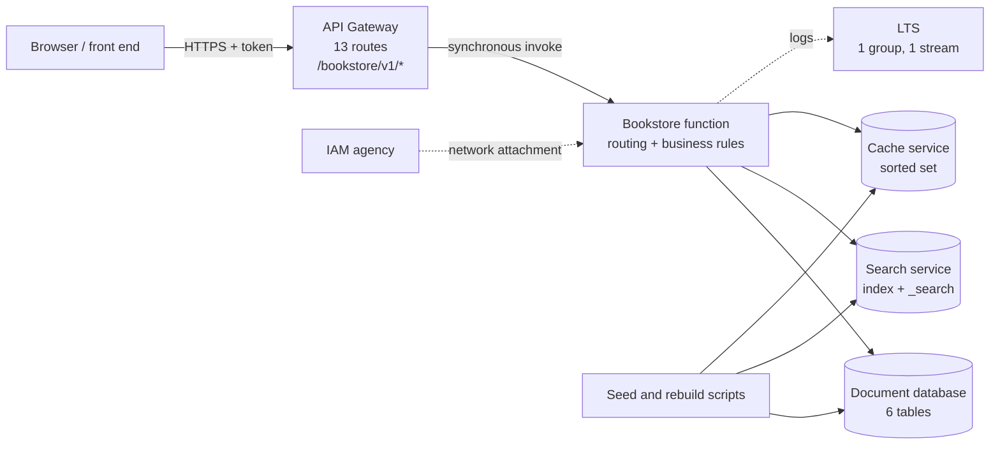

# Full-Stack Online Bookstore

[](LICENSE)
[](https://www.huaweicloud.com)

A full-stack bookstore that runs end to end: browse books, browse categories, keyword search,
shopping cart, checkout, order history, bestsellers and two kinds of recommendations. The backend is
one function carrying 13 REST routes, with data spread across a document database, a search service
and a cache service. It suits teams that want to see once how search, ranking and recommendations
fit together in a real commerce workload.

## Overview

The bookstore's capability boundary is clear, but wiring it up needs four different storage shapes:

- **Catalog and transaction data** — books, carts, orders, friendships and purchase history: six
  tables in a document database.
- **Search** — keyword matching needs an inverted index, served by the search service index and
  query API.
- **Ranking** — bestsellers are a sorted-set problem, served by the cache service with a read-heavy,
  write-light access pattern.
- **Recommendations** — friend-purchase and related-book recommendations are aggregations over the
  data above and need no extra store.

Two cross-cutting concerns sit above the four data planes: **identity**, carried by a controlled
signing token where `sub` is the only user boundary, and **observability**, carried by an explicit
log group and log stream in LTS.

**What it solves**: it turns "one complete bookstore business loop" into a deployable, verifiable
and rebuildable sample, and places each storage type where it fits best instead of piling everything
into one table.

**Who it is for**: teams designing commerce or content platforms that need a reference for how
search and ranking divide responsibilities, and teams decomposing an existing monolith into a
serverless shape.

## Table of Contents

- [Architecture](#architecture)
- [Highlights](#highlights)
- [Cloud Services](#cloud-services)
- [Prerequisites](#prerequisites)
- [Quick Start](#quick-start)
- [Step-by-step Deployment](#step-by-step-deployment)
- [Usage and Verification](#usage-and-verification)
- [Repository Layout](#repository-layout)
- [Clean Up](#clean-up)
- [Further Reading](#further-reading)
- [FAQ](#faq)
- [License](#license)
- [Contact](#contact)

## Architecture



Each data plane does one job: transactions in the document database, keyword queries in the search
service, rankings in the cache service.

| Layer | Service | Description |
|-|-|-|
| Ingress | API Gateway dedicated instance | Group + environment + 13 APIs + publications, prefix `/bookstore/v1/` |
| Compute | FunctionGraph | 1 Python 3.10 function, 128 MB / 15 s, single-file inline |
| Transaction data | Document database (compatible interface) | Six tables with a conditional-write entry point |
| Search | Search service (compatible interface) | Index creation, document writes, `_search` queries |
| Ranking | Cache service | Sorted set `<namespace>:bestsellers` |
| Observability | LTS | One log group and one log stream |

## Highlights

- **Four storage types, each used well** — transactions in the document store, search through an
  inverted index, rankings in a sorted set; neither search nor ranking is forced into the primary
  store.
- **Read models are rebuildable** — both the search index and the bestseller list are read models
  that a single script can rebuild from primary data at any time, making rebuildability a stated
  contract.
- **The API covers the full loop** — from browsing and cart to checkout, orders, ranking and
  recommendations, with sixteen end-to-end checks that all pass.
- **A clear identity boundary** — the token's `sub` is the only user identifier; user fields in the
  request body never participate in authorization.
- **An in-memory implementation is included** — the same code runs in a local memory mode, so unit
  tests need no cloud resources.
- **All four log parameters bound** — the group and stream are created explicitly and both IDs and
  names are bound on the function.

## Cloud Services

| Service | Role in this sample | Terraform resource |
|-|-|-|
| FunctionGraph | Hosts the bookstore function | `huaweicloud_fgs_function` |
| API Gateway | Group, environment, 13 APIs and publications (may reuse a shared instance) | `huaweicloud_apig_group`, `huaweicloud_apig_environment`, `huaweicloud_apig_api`, `huaweicloud_apig_api_publishment`, `huaweicloud_apig_instance` |
| VPC (network and security group) | Network, subnet and security group when deployed standalone | `huaweicloud_vpc`, `huaweicloud_vpc_subnet`, `huaweicloud_networking_secgroup` |
| LTS | One log group and one log stream | `huaweicloud_lts_group`, `huaweicloud_lts_stream` |
| IAM | Agency for network attachment | `huaweicloud_identity_agency` |
| Document database (compatible interface) | Six business tables | Initialized by `src/scripts/seed.py` |
| Search service | Book index and queries | Index created by `src/scripts/seed.py` |
| Cache service | Bestseller sorted set | Maintained by the write path and the rebuild script |

Release these resources when the sample is no longer needed, to avoid leaving them behind.

## Prerequisites

**Account and permissions**

- An account that has completed real-name verification, with `cn-north-4` available (this sample
  was verified there).
- Permission to enable and operate FunctionGraph, API Gateway, LTS, the document database, the
  search service and the cache service.
- Access Key ID and Secret Access Key from the "My Credentials" page, supplied to the deployment
  shell. Never write credentials into code or commit them.

**External resources already in place**

- An API Gateway dedicated instance, or let this sample create one.
- A document database instance, a search service instance and a cache service instance, with their
  addresses and credentials.
- If those instances use private addresses, the shared network and subnet IDs so the function can be
  attached.

**Tools and versions**

- Terraform CLI `>= 1.5`, huaweicloud provider `>= 1.95`, Python 3.9 or later.

**Region and naming constraints**

- `var.namespace` determines table names and the cache key prefix: it must start with a letter, may
  contain underscores, and is 3 to 31 characters long.
- `var.search_index` must start with `<namespace>-` so that deployments sharing the search service
  never mix data.
- The gateway instance and environment must be supplied as a pair; the same applies to the shared
  network and subnet.

## Quick Start

```bash
# 1. Local unit tests (offline)
cd src && python -m pytest tests -q && cd ..

# 2. Static checks
cd infra && terraform init && terraform validate && cd ..

# 3. Supply deployment values and create resources
cd infra
export HW_ACCESS_KEY=<HW_ACCESS_KEY>
export HW_SECRET_KEY=<HW_SECRET_KEY>
export TF_VAR_shared_apig_instance_id="<API Gateway dedicated instance ID>"
export TF_VAR_shared_apig_env_id="<shared environment ID>"
export TF_VAR_gemini_endpoint="<data plane address>"
export TF_VAR_gemini_access_key="<data plane access key ID>"
export TF_VAR_gemini_secret_key="<data plane secret access key>"
export TF_VAR_css_endpoint="<search service address>"
export TF_VAR_css_username="<search username>"
export TF_VAR_css_password="<search password>"
export TF_VAR_dcs_endpoint="<cache service address>"
export TF_VAR_dcs_password="<cache password>"
export TF_VAR_jwt_secret="<token signing secret>"
terraform plan -out=bookstore.tfplan
terraform apply bookstore.tfplan

# 4. Load sample data and verify
cd ..
python src/scripts/seed.py
python src/scripts/verify_e2e.py
```

## Step-by-step Deployment

### Step 1: Local unit tests

```bash
cd src
python -m pytest tests -q
cd ..
```

Expected output:

```text
13 passed in 0.03s
```

The tests cover token validation, domain rules, sample fixtures and data plane adapters, all against
the in-memory implementation.

### Step 2: Static checks

```bash
cd infra
terraform init
terraform validate
```

Expected output:

```text
Success! The configuration is valid, but there were some
validation warnings as shown above.
```

### Step 3: Supply deployment values

The values fall into three groups: ingress and network, data plane credentials, search and cache.

```bash
# Ingress and network
export TF_VAR_shared_apig_instance_id="<API Gateway dedicated instance ID>"
export TF_VAR_shared_apig_env_id="<shared environment ID>"
export TF_VAR_shared_vpc_id="<shared network ID>"
export TF_VAR_shared_network_id="<shared subnet network_id>"

# Data plane
export TF_VAR_gemini_endpoint="<data plane address>"
export TF_VAR_gemini_access_key="<data plane access key ID>"
export TF_VAR_gemini_secret_key="<data plane secret access key>"

# Search and cache
export TF_VAR_css_endpoint="<search service address>"
export TF_VAR_css_username="<search username>"
export TF_VAR_css_password="<search password>"
export TF_VAR_dcs_endpoint="<cache service address>"
export TF_VAR_dcs_password="<cache password>"

# Token signing
export TF_VAR_jwt_secret="<token signing secret>"
```

Optional values (the full list is in `infra/variables.tf`):

| Variable | Default | Description |
|-|-|-|
| `region` | `cn-north-4` | Deployment region |
| `app_name` | `bookstore-hw` | Resource name prefix |
| `namespace` | `bookstore_hw` | Data namespace |
| `vpc_cidr` / `subnet_cidr` | `192.168.0.0/16` / `192.168.10.0/24` | Network ranges when deployed standalone |
| `gemini_port` / `gemini_protocol` / `gemini_region` | `8000` / `http` / `cn-north-4` | Data plane connection and signing |
| `css_port` / `css_tls` / `css_tls_verify` | `443` / `true` / `true` | Search service access |
| `dcs_port` / `dcs_tls` | `6379` / `true` | Cache service access |
| `search_index` | `bookstore_hw-books` | Index name; must start with `<namespace>-` |
| `jwt_issuer` / `jwt_audience` | empty | Left empty, they are not validated |

### Step 4: Create resources

```bash
cd infra
terraform plan -out=bookstore.tfplan
terraform apply bookstore.tfplan
```

Expected output (reusing a shared gateway):

```text
Plan: 19 to add, 0 to change, 0 to destroy.
Apply complete! Resources: 19 added, 0 changed, 0 destroyed.
```

Deploying a standalone gateway adds a network, subnet, security group, gateway instance and
environment, for 24 resources in total.

### Step 5: Load sample data

```bash
python src/scripts/seed.py
```

Expected output:

```text
[INFO] books: 8 written
[INFO] friends: 3 written
[INFO] purchases: 5 written
[INFO] index <namespace>-books ready
```

The script reads fixed sample data from `src/fixtures/`, writes six tables and creates the index. It
is idempotent.

### Step 6: Read the outputs

```bash
terraform output
```

Common values:

```bash
terraform output api_base_url          # bookstore API base (includes /bookstore/v1)
terraform output data_plane_probe      # configuration status of the three data planes
```

## Usage and Verification

### Minimal example: browse books

```bash
export BASE="$(terraform output -raw api_base_url)"
export TOKEN="<token produced by the token script>"

curl -s "$BASE/books" -H "Authorization: Bearer $TOKEN" | head -c 300
```

Expected: a book array (8 books in the sample data).

### Run all sixteen checks at once

```bash
python src/scripts/verify_e2e.py
```

Expected tail:

```json
{"passed": true, "checks": 16}
```

The sixteen checks cover book listing, single book, category listing, category books, search, add to
cart, cart read, adding another item, checkout twice (verifying idempotency), order listing, single
order, bestsellers, friend recommendations and related-book recommendations.

### Verify search

```bash
curl -s "$BASE/search?q=python" -H "Authorization: Bearer $TOKEN"
```

Expected: matching results (1 in the sample data).

### Verify checkout and ranking

```bash
curl -X PUT "$BASE/cart/book-001" -H "Authorization: Bearer $TOKEN"
curl -X POST "$BASE/checkout" -H "Authorization: Bearer $TOKEN"
curl -s "$BASE/bestsellers" -H "Authorization: Bearer $TOKEN"
```

Checkout is expected to return 201 with an order identifier; repeating it for the same cart does not
create a duplicate order. The bestseller list should then include that book, with a length of 5 for
the sample data.

### Verify recommendations

```bash
curl -s "$BASE/recommendations/friends" -H "Authorization: Bearer $TOKEN"
curl -s "$BASE/recommendations/books/book-001" -H "Authorization: Bearer $TOKEN"
```

Expected: 3 and 2 results respectively, matching the sample data.

### Verify the identity boundary

Calling any read or write endpoint without a token returns 401:

```bash
curl -s -o /dev/null -w "%{http_code}\n" "$BASE/books"
```

Expected `401`. A user's token cannot read another user's cart — the boundary is decided solely by
the token's `sub`.

**After deployment, run the steps in this section in your own environment and confirm the features
work before treating the delivery as complete.**

## Repository Layout

```text
.
├── README.md
├── README.en.md
├── LICENSE
├── docs/
│   ├── architecture.md          Business layers, data flow and trade-offs
│   └── deployment-guide.md      Step-by-step commands with expected output
├── infra/
│   ├── versions.tf              Terraform and provider version constraints
│   ├── variables.tf             Input variables and paired validations
│   ├── main.tf                  Network, logs, agency, function, gateway
│   ├── outputs.tf               Outputs
│   └── terraform.tfvars.example Input example
└── src/
    ├── app.py                   Entry function: routing, auth, business rules and four data adapters
    ├── auth.py / domain.py / ranking.py / search.py / store.py   Re-export layer for local tools
    ├── fixtures/                Sample data
    ├── frontend/                Front-end views and build script
    ├── scripts/
    │   ├── seed.py              Sample data loading
    │   ├── rebuild_projections.py  Read model rebuild
    │   ├── upload_obs.py        Static site upload
    │   ├── cleanup.py           Namespace-scoped data cleanup
    │   └── verify_e2e.py        Post-deployment verification
    └── tests/                   Unit tests
```

## Clean Up

```bash
cd infra
terraform destroy
```

Expected output:

```text
Destroy complete! Resources: 19 destroyed.
```

Destroy removes the function, group/environment/APIs/publications, log group and stream, and the
agency; a standalone deployment also removes the network and gateway instance. The data plane, the
search instance, the cache instance and the static bucket are shared resources and outside this
directory's cleanup scope.

To clear this namespace's data:

```bash
python src/scripts/cleanup.py
```

That command touches only tables and indexes in this namespace.

## Further Reading

- Business layers, end-to-end data flow and trade-offs: [docs/architecture.md](docs/architecture.md)
- Complete commands from zero to a verified deployment: [docs/deployment-guide.md](docs/deployment-guide.md)
- Chinese edition: [README.md](README.md)

## FAQ

**Every endpoint returns 401.**
The token is missing, the signing secret differs, or the token expired. Confirm `TF_VAR_jwt_secret`
matches the value used when the token was issued.

**An endpoint returns 502.**
The data plane call failed. Check five things: address, port, protocol, signing region and
credentials.

**Search returns nothing.**
Check whether the index was created and populated, and whether `search_index` matches the value used
during loading (it must start with `<namespace>-`).

**The bestseller list is empty.**
Check whether at least one checkout has happened, and whether the cache key prefix matches
`namespace`.

**Checkout creates a duplicate order.**
Idempotency relies on the cart snapshot and order deduplication. If the same cart is not cleared
after checkout, a repeated submission produces a second order — that is intentional business
semantics; clear the cart after checkout when strict idempotency is required.

**The function cannot reach a private data plane.**
Check whether the shared network and subnet are configured as a pair; `function_network_configured`
in the outputs confirms whether attachment happened.

**Logs are empty.**
The function must bind all four log parameters: group ID, group name, stream ID and stream name.

## License

This sample is released under the MIT No Attribution license. See [LICENSE](LICENSE).

## Contact

Created and maintained by: Public Cloud Continuous Operations Department.

Please open an issue in this repository if you run into problems; we review them regularly.
