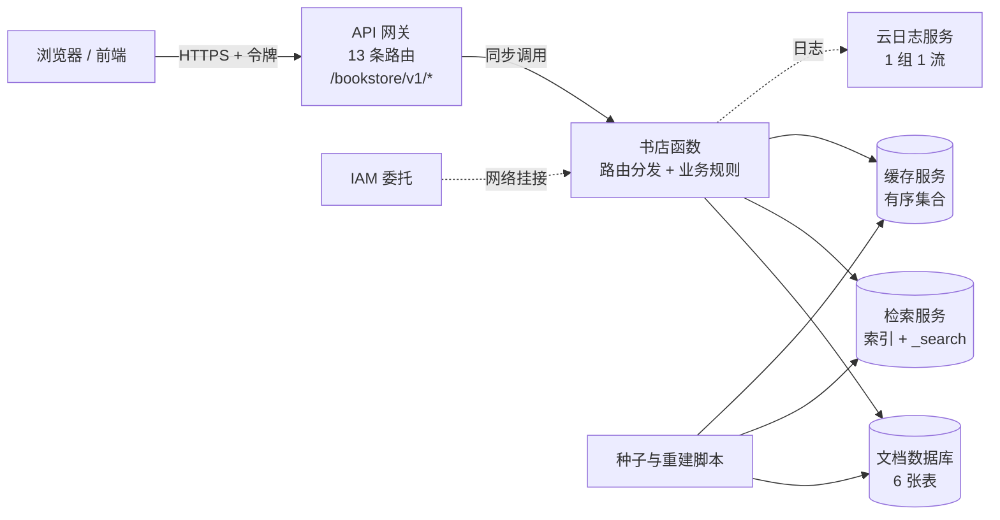

# 全栈网上书店实践

[](LICENSE)
[](https://www.huaweicloud.com)

一套可以完整跑通的全栈书店：书目浏览、类目浏览、关键字搜索、购物车、结算下单、
订单历史、畅销榜与两类推荐。后端是一个函数承载的 13 条 REST 路由，
数据分放在文档数据库、检索服务与缓存服务中。适用于想一次看到「搜索 + 排行 + 推荐」
这类电商常见能力如何组合落地的团队。

## 简介

书店业务的能力边界很清楚，但要把它们接起来需要四种不同的存储形态：

- **书目与交易数据**：书目、购物车、订单、好友关系、购买记录，共六张表，走文档数据库。
- **搜索**：关键字匹配需要倒排索引，走检索服务的索引与查询接口。
- **排行**：畅销榜是有序集合问题，走缓存服务的有序集合，读多写少。
- **推荐**：好友购买推荐与相关书目推荐，是对上述数据的聚合计算，不引入额外存储。

四条数据面之外还有两个横切能力：**身份**用受控签名令牌承载（`sub` 是唯一用户边界），
**观测**用云日志服务的显式日志组与日志流承载。

**解决的问题**：把「一个完整的书店业务闭环」做成可部署、可验证、可重建的样例，
同时把每一类存储用在其最合适的位置，而不是全部塞进一张表。

**适用于**：正在设计电商或内容平台、需要参考搜索与排行如何分工的团队；
想把现有单体书店应用拆成无服务器形态的团队。

## 目录

- [架构图](#架构图)
- [方案亮点](#方案亮点)
- [涉及云服务](#涉及云服务)
- [前置条件](#前置条件)
- [快速开始](#快速开始)
- [分步部署](#分步部署)
- [使用方法与验证](#使用方法与验证)
- [仓库结构](#仓库结构)
- [清理资源](#清理资源)
- [详细说明](#详细说明)
- [常见问题](#常见问题)
- [许可证](#许可证)
- [联系方式](#联系方式)

## 架构图



四类数据面各司其职：文档数据库承载交易数据，检索服务承载关键字查询，缓存服务承载排行榜。

| 层次 | 承担的服务 | 说明 |
|-|-|-|
| 入口 | API 网关专享实例 | 分组 + 环境 + 13 条 API + 发布，统一前缀 `/bookstore/v1/` |
| 计算 | 函数计算 | 1 个 Python 3.10 函数，128 MB / 15 秒，单文件内联 |
| 交易数据 | 文档数据库（兼容接口） | 六张表，含条件写入入口 |
| 搜索 | 检索服务（兼容接口） | 索引创建、文档写入、`_search` 查询 |
| 排行 | 缓存服务 | 有序集合 `<命名空间>:bestsellers` |
| 观测 | 云日志服务 | 一个日志组与一条日志流 |

## 方案亮点

- **四类存储各用其所**：交易走文档库、搜索走倒排索引、排行榜走有序集合，
  不把搜索或排行硬压进主库。
- **读模型可重建**：搜索索引与畅销榜都是读模型，任何时候可用一个脚本从主数据重建，
  可重建性成为明确契约。
- **接口覆盖完整业务闭环**：从浏览、加购、结算到订单、排行、推荐，十六项端到端校验全部可跑通。
- **身份边界清晰**：令牌的 `sub` 是唯一用户标识，请求体里的用户字段不参与授权。
- **内存实现在位**：同一份代码支持本地内存模式，单元测试无需任何云端资源。
- **绑定四参数不丢日志**：显式建组与建流，并在函数上同时绑定组与流的 ID 与名称。

## 涉及云服务

| 云服务 | 本实践中的职责 | 对应 Terraform 资源 |
|-|-|-|
| 函数计算 | 承载书店业务函数 | `huaweicloud_fgs_function` |
| API 网关 | 分组、环境、13 条 API 与发布（可复用共享实例） | `huaweicloud_apig_group`、`huaweicloud_apig_environment`、`huaweicloud_apig_api`、`huaweicloud_apig_api_publishment`、`huaweicloud_apig_instance` |
| 虚拟私有云（网络与安全组） | 独立部署时的网络、子网与安全组 | `huaweicloud_vpc`、`huaweicloud_vpc_subnet`、`huaweicloud_networking_secgroup` |
| 云日志服务 | 一个日志组与一条日志流 | `huaweicloud_lts_group`、`huaweicloud_lts_stream` |
| 统一身份认证服务 | 网络挂接所需委托 | `huaweicloud_identity_agency` |
| 文档数据库（兼容接口） | 六张业务表 | 由 `src/scripts/seed.py` 初始化 |
| 检索服务 | 书目索引与查询 | 由 `src/scripts/seed.py` 创建索引 |
| 缓存服务 | 畅销榜有序集合 | 由业务写路径与重建脚本维护 |

确认不再需要本实践后，及时释放上述资源，避免残留。

## 前置条件

**账号与权限**

- 已开通账号并完成实名认证，可用区域为 `cn-north-4`（本实践在该区域验证）。
- 具备函数计算、API 网关、云日志服务、文档数据库、检索服务与缓存服务的开通与操作权限。
- 在「我的凭证」页面获取 Access Key ID 与 Secret Access Key，填入部署脚本；
  不要把凭据写入代码或提交到仓库。

**已就绪的外部资源**

- 一个 API 网关专享实例（或让本实践自建一个）。
- 一个文档数据库实例、一个检索服务实例、一个缓存服务实例，以及它们的访问地址与凭据。
- 若上述实例为私网地址，需准备共享网络与子网 ID，并把函数挂接上去。

**工具与版本**

- Terraform CLI `>= 1.5`，huaweicloud Provider `>= 1.95`，Python 3.9 及以上。

**区域与命名约束**

- `var.namespace` 决定表名与缓存键前缀，须字母开头、可含下划线、长度 3~31。
- `var.search_index` 必须以 `<namespace>-` 开头，避免多个部署共用索引时串数据。
- 网关实例与环境必须成对提供；共享网络与子网必须成对提供。

## 快速开始

```bash
# 1. 本地单元测试（离线）
cd src && python -m pytest tests -q && cd ..

# 2. 静态校验
cd infra && terraform init && terraform validate && cd ..

# 3. 填写部署参数并创建资源
cd infra
export HW_ACCESS_KEY=<HW_ACCESS_KEY>
export HW_SECRET_KEY=<HW_SECRET_KEY>
export TF_VAR_shared_apig_instance_id="<APIG 专享实例 ID>"
export TF_VAR_shared_apig_env_id="<共享环境 ID>"
export TF_VAR_gemini_endpoint="<数据面地址>"
export TF_VAR_gemini_access_key="<数据面访问密钥 ID>"
export TF_VAR_gemini_secret_key="<数据面访问密钥 Secret>"
export TF_VAR_css_endpoint="<检索服务地址>"
export TF_VAR_css_username="<检索用户名>"
export TF_VAR_css_password="<检索密码>"
export TF_VAR_dcs_endpoint="<缓存服务地址>"
export TF_VAR_dcs_password="<缓存密码>"
export TF_VAR_jwt_secret="<令牌签名密钥>"
terraform plan -out=bookstore.tfplan
terraform apply bookstore.tfplan

# 4. 装载样例数据并验证
cd ..
python src/scripts/seed.py
python src/scripts/verify_e2e.py
```

## 分步部署

### 第 1 步：本地单元测试

```bash
cd src
python -m pytest tests -q
cd ..
```

预期输出：

```text
13 passed in 0.03s
```

测试覆盖令牌校验、领域规则、样例夹具与数据面适配，全部使用内存实现。

### 第 2 步：静态校验

```bash
cd infra
terraform init
terraform validate
```

预期输出：

```text
Success! The configuration is valid, but there were some
validation warnings as shown above.
```

### 第 3 步：填写部署参数

参数分三组：入口与网络、数据面凭据、检索与缓存。

```bash
# 入口与网络
export TF_VAR_shared_apig_instance_id="<APIG 专享实例 ID>"
export TF_VAR_shared_apig_env_id="<共享环境 ID>"
export TF_VAR_shared_vpc_id="<共享网络 ID>"
export TF_VAR_shared_network_id="<共享子网 network_id>"

# 数据面
export TF_VAR_gemini_endpoint="<数据面地址>"
export TF_VAR_gemini_access_key="<数据面访问密钥 ID>"
export TF_VAR_gemini_secret_key="<数据面访问密钥 Secret>"

# 检索与缓存
export TF_VAR_css_endpoint="<检索服务地址>"
export TF_VAR_css_username="<检索用户名>"
export TF_VAR_css_password="<检索密码>"
export TF_VAR_dcs_endpoint="<缓存服务地址>"
export TF_VAR_dcs_password="<缓存密码>"

# 令牌密钥
export TF_VAR_jwt_secret="<令牌签名密钥>"
```

可选参数（完整清单见 `infra/variables.tf`）：

| 变量 | 默认值 | 说明 |
|-|-|-|
| `region` | `cn-north-4` | 部署区域 |
| `app_name` | `bookstore-hw` | 资源名称前缀 |
| `namespace` | `bookstore_hw` | 数据命名空间 |
| `vpc_cidr` / `subnet_cidr` | `192.168.0.0/16` / `192.168.10.0/24` | 自建实例时的网络网段 |
| `gemini_port` / `gemini_protocol` / `gemini_region` | `8000` / `http` / `cn-north-4` | 数据面连接与签名 |
| `css_port` / `css_tls` / `css_tls_verify` | `443` / `true` / `true` | 检索服务接入 |
| `dcs_port` / `dcs_tls` | `6379` / `true` | 缓存服务接入 |
| `search_index` | `bookstore_hw-books` | 索引名，须以 `<namespace>-` 开头 |
| `jwt_issuer` / `jwt_audience` | 空 | 留空则不校验 |

### 第 4 步：创建资源

```bash
cd infra
terraform plan -out=bookstore.tfplan
terraform apply bookstore.tfplan
```

预期输出（复用共享网关时）：

```text
Plan: 19 to add, 0 to change, 0 to destroy.
Apply complete! Resources: 19 added, 0 changed, 0 destroyed.
```

自建网关实例时另加网络、子网、安全组、网关实例与环境，共 24 项。

### 第 5 步：装载样例数据

```bash
python src/scripts/seed.py
```

预期输出：

```text
[INFO] books: 8 written
[INFO] friends: 3 written
[INFO] purchases: 5 written
[INFO] index <namespace>-books ready
```

脚本从 `src/fixtures/` 读取固定样例数据，写入六张表并建索引，幂等可重复执行。

### 第 6 步：查看部署输出

```bash
terraform output
```

常用取值：

```bash
terraform output api_base_url          # 书店 API 基地址（含 /bookstore/v1）
terraform output data_plane_probe      # 三个数据面的配置状态
```

## 使用方法与验证

### 最简示例：浏览书目

```bash
export BASE="$(terraform output -raw api_base_url)"
export TOKEN="<由令牌生成脚本产出的令牌>"

curl -s "$BASE/books" -H "Authorization: Bearer $TOKEN" | head -c 300
```

预期返回书目数组（样例数据 8 本）。

### 一次跑完十六项校验

```bash
python src/scripts/verify_e2e.py
```

预期输出结尾：

```json
{"passed": true, "checks": 16}
```

十六项覆盖：书目列表、单本书目、类目列表、类目下书目、搜索、加购、购物车读取、
再加一件、结算（两次，验证幂等）、订单列表、单笔订单、畅销榜、好友推荐、相关书目推荐。

### 验证搜索

```bash
curl -s "$BASE/search?q=python" -H "Authorization: Bearer $TOKEN"
```

预期返回命中结果（样例数据中 1 条）。

### 验证结算与排行榜

```bash
curl -X PUT "$BASE/cart/book-001" -H "Authorization: Bearer $TOKEN"
curl -X POST "$BASE/checkout" -H "Authorization: Bearer $TOKEN"
curl -s "$BASE/bestsellers" -H "Authorization: Bearer $TOKEN"
```

结算预期返回 201 与订单标识；重复提交同一购物车不产生重复订单。
畅销榜随后出现该书目，样例数据下榜单长度为 5。

### 验证推荐

```bash
curl -s "$BASE/recommendations/friends" -H "Authorization: Bearer $TOKEN"
curl -s "$BASE/recommendations/books/book-001" -H "Authorization: Bearer $TOKEN"
```

预期分别返回 3 条与 2 条（与样例数据一致）。

### 验证身份边界

不带令牌访问任一读写接口会返回 401：

```bash
curl -s -o /dev/null -w "%{http_code}\n" "$BASE/books"
```

预期输出 `401`。用一个用户的令牌读取另一个用户的购物车不会返回对方数据——
用户边界只由令牌的 `sub` 决定。

**部署完成后请按本节步骤在真实环境自行验证，确认功能可用后方可视为交付完成。**

## 仓库结构

```text
.
├── README.md
├── README.en.md
├── LICENSE
├── docs/
│   ├── architecture.md          业务分层、数据流与关键设计取舍
│   └── deployment-guide.md      分步部署命令与每步预期输出
├── infra/
│   ├── versions.tf              Terraform 与 Provider 版本约束
│   ├── variables.tf             输入变量与成对校验
│   ├── main.tf                  网络、日志、委托、函数、网关
│   ├── outputs.tf               对外输出
│   └── terraform.tfvars.example 输入示例
└── src/
    ├── app.py                   入口函数：路由、鉴权、业务规则与四类数据适配
    ├── auth.py / domain.py / ranking.py / search.py / store.py   本地工具用的导出层
    ├── fixtures/                样例数据
    ├── frontend/                前端视图与构建脚本
    ├── scripts/
    │   ├── seed.py              样例数据装载
    │   ├── rebuild_projections.py  读模型重建
    │   ├── upload_obs.py        静态站上传
    │   ├── cleanup.py           本命名空间数据清理
    │   └── verify_e2e.py        部署后校验
    └── tests/                   单元测试
```

## 清理资源

```bash
cd infra
terraform destroy
```

预期输出：

```text
Destroy complete! Resources: 19 destroyed.
```

销毁会删除函数、分组/环境/API/发布、日志组与日志流、委托；自建实例时一并删除网络与网关实例。
数据面实例、检索实例、缓存实例与静态桶属共享资源，不在本目录的清理范围。

需要清空本命名空间的数据时执行：

```bash
python src/scripts/cleanup.py
```

该命令只作用于本命名空间的表与索引。

## 详细说明

- 业务分层、端到端数据流与关键设计取舍：[docs/architecture.md](docs/architecture.md)
- 从零到可验证部署的完整命令与预期输出：[docs/deployment-guide.md](docs/deployment-guide.md)
- 英文版说明：[README.en.md](README.en.md)

## 常见问题

**全部接口返回 401。**
令牌缺失、签名密钥不一致或已过期。先确认 `TF_VAR_jwt_secret` 与签发令牌时一致。

**接口返回 502。**
数据面调用异常。核对地址、端口、协议、签名区域与凭据五项。

**搜索无结果。**
索引是否已创建并写入；`search_index` 是否与装载时一致（必须以 `<namespace>-` 开头）。

**畅销榜为空。**
是否已完成至少一次结算；缓存键前缀是否与 `namespace` 一致。

**结算重复下单。**
幂等依赖购物车快照与订单去重。若同一购物车在结算后未清空，重复提交会产生第二笔订单——
这是有意的业务语义，需要严格幂等时应在结算后清空购物车。

**函数无法访问私网数据面。**
共享网络与子网是否成对配置；可查看输出 `function_network_configured` 确认是否已挂接。

**日志为空。**
函数必须同时绑定日志组 ID / 名称与日志流 ID / 名称四个参数。

## 许可证

本实践采用 MIT No Attribution 许可证发布，详见 [LICENSE](LICENSE)。

## 联系方式

创建与维护团队：公有云持续运营部。

使用中遇到问题请在本仓库提交议题，我们会定期查看。
