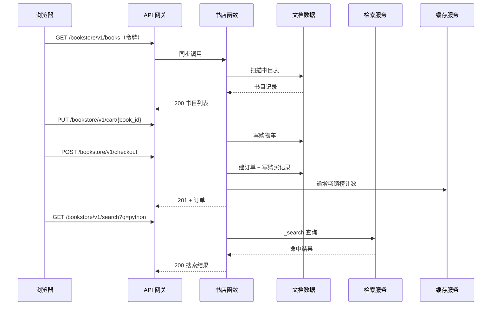
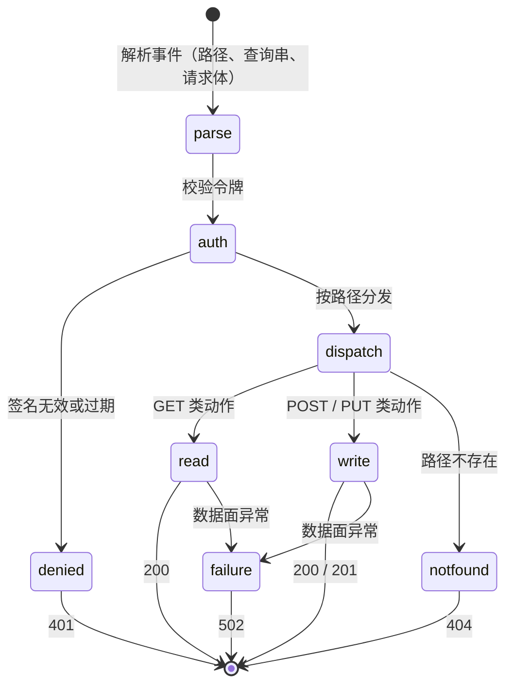
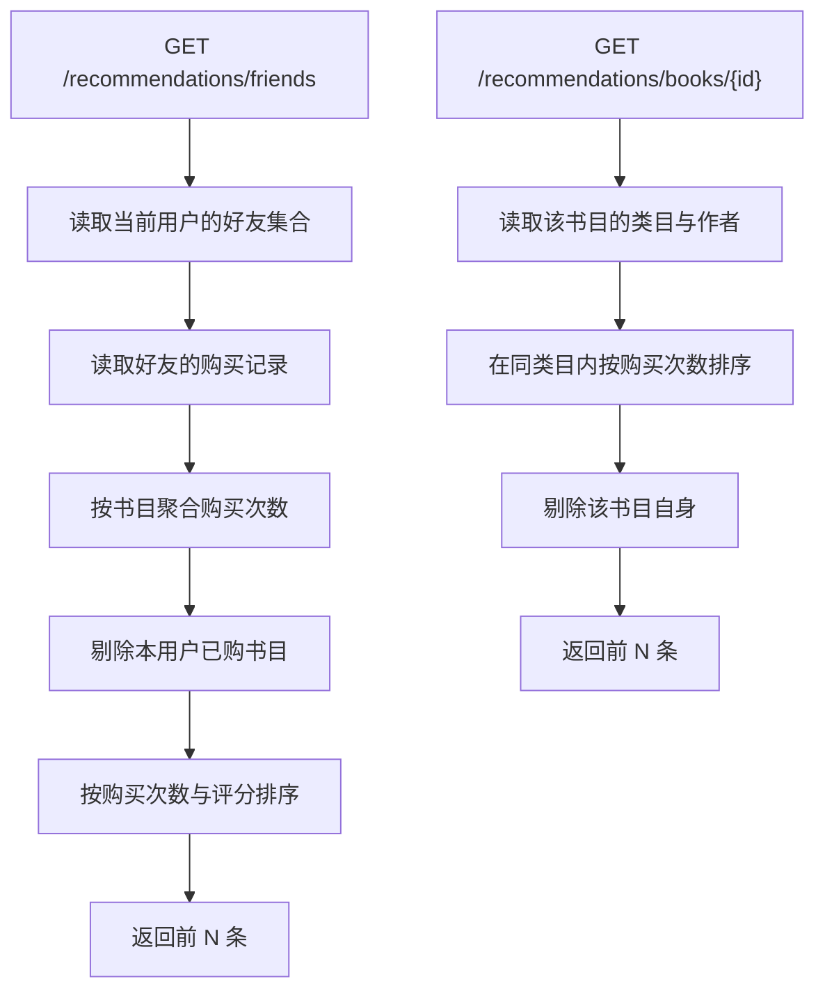

# 架构与技术设计

本文说明本实践的书店架构组成、端到端数据流与关键设计取舍。
部署命令见 [deployment-guide.md](deployment-guide.md)，功能概览见仓库根目录 `README.md`。

## 1. 分层与职责

| 层 | 职责 | 落地位置 |
|-|-|-|
| 入口层 | 13 条 REST 路由，统一前缀 `/bookstore/v1/` | `infra/main.tf` 的分组、环境、13 条 API 与发布 |
| 应用层 | 路由分发、鉴权、业务规则 | `src/app.py` 的 `route()` 与 `BookstoreService` |
| 数据层 | 六张表的读写与条件写 | `src/app.py` 的 `GeminiStore`（另有内存实现） |
| 检索层 | 索引创建、文档写入与查询 | `src/app.py` 的 `CSSSearch` |
| 排行层 | 有序集合的增减与读取 | `src/app.py` 的 `DCSRanking` |
| 观测层 | 运行日志 | `infra/main.tf` 的日志组与日志流 |

## 2. 组件清单

### 2.1 入口函数（`infra/main.tf`）

单个函数 `bookstore`（Python 3.10 / 128 MB / 15 秒），代码以单文件内联部署，
承载全部 13 条路由。函数挂接共享网络时同时挂 VPC 与子网，用于访问私网数据面。

### 2.2 路由（`infra/main.tf` 的 `local.api_routes`）

| 方法 | 路径 | 说明 |
|-|-|-|
| ANY | `/bookstore/v1/books` | 书目列表 |
| ANY | `/bookstore/v1/books/{book_id}` | 单本书目 |
| ANY | `/bookstore/v1/categories` | 类目列表 |
| ANY | `/bookstore/v1/categories/{category}` | 类目下书目 |
| ANY | `/bookstore/v1/cart` | 购物车读写 |
| ANY | `/bookstore/v1/cart/{book_id}` | 购物车条目 |
| POST | `/bookstore/v1/checkout` | 结算下单 |
| GET | `/bookstore/v1/orders` | 订单列表 |
| GET | `/bookstore/v1/orders/{order_id}` | 单笔订单 |
| GET | `/bookstore/v1/search` | 关键字搜索 |
| GET | `/bookstore/v1/bestsellers` | 畅销榜 |
| GET | `/bookstore/v1/recommendations/friends` | 好友购买推荐 |
| GET | `/bookstore/v1/recommendations/books/{book_id}` | 相关书目推荐 |

### 2.3 数据模型

| 表 | 主键 | 用途 |
|-|-|-|
| `books` | `id` | 书目（标题、作者、类目、售价、评分） |
| `carts` | `user_id` | 购物车条目集合 |
| `orders` | `id` | 订单（用户、条目、金额、状态） |
| `friends` | `user_id` + `friend_id` | 好友关系 |
| `purchases_by_user` | `user_id` + `book_id` | 购买记录（推荐输入） |
| `orders_by_user` | `user_id` + `order_id` | 按用户查订单的读模型 |

六张表由 `src/scripts/seed.py` 在数据装载阶段创建并写入初始数据；
写路径保留 `attribute_not_exists` 条件表达式入口。

### 2.4 检索与排行

- 检索：索引在数据装载时创建（已存在则继续），文档按书目写入，查询走 `_search`；
  支持按标题、作者、类目匹配。
- 排行：有序集合键为 `<命名空间>:bestsellers`，结算时递增计数，读取返回前若干名。

### 2.5 观测与权限

- 1 个日志组与 1 条日志流，函数绑定四个参数。
- 1 个委托授予网络只读角色；挂接共享网络时函数可达私网数据面与检索、缓存端点。
- 自建网关实例时另建网络、子网与安全组；复用共享实例时三者均不创建。

## 3. 端到端数据流

### 3.1 一次购书到下单的完整时序

### 3.2 请求分发的状态机

### 3.3 推荐计算

### 3.4 云侧调用面

| 调用面 | 用途 | 协议 |
|-|-|-|
| 文档数据 | 六张表读写、条件写、查询与扫描 | 兼容接口的 JSON 协议 + 请求签名 |
| 检索服务 | 索引创建、文档写入、`_search` 查询 | 兼容接口的 HTTP JSON |
| 缓存服务 | 有序集合递增与范围查询 | RESP 文本协议 |
| 令牌校验 | 校验签名与有效期 | 本地计算，不发起调用 |

## 4. 运行期配置契约

函数的环境配置由 `local.function_env` 合并而成，只取已声明的键。

| 键 | 用途 |
|-|-|
| `BOOKSTORE_NAMESPACE` | 表名前缀与缓存键前缀 |
| `BOOKSTORE_MODE` | `cloud` 或 `local`，决定是否使用真实数据面 |
| `JWT_SECRET` | 令牌签名密钥（敏感） |
| `JWT_ISSUER` / `JWT_AUDIENCE` | 可选，令牌签发者与受众 |
| `GEMINI_ENDPOINT` / `PORT` / `PROTOCOL` / `REGION` | 文档数据地址与签名区域 |
| `GEMINI_ACCESS_KEY` / `GEMINI_SECRET_KEY` | 文档数据凭据（敏感） |
| `CSS_ENDPOINT` / `PORT` / `TLS` / `TLS_VERIFY` / `USERNAME` / `PASSWORD` / `TOKEN` / `INDEX` | 检索服务接入 |
| `DCS_ENDPOINT` / `PORT` / `TLS` / `PASSWORD` | 缓存服务接入 |

必填项在入口一次性校验，缺项时返回明确错误而不是链路中途失败。

## 5. 关键设计取舍

### 5.1 为什么 13 条路由收敛到一个函数

书店的 13 条路由共享同一套数据模型、令牌校验与序列化。拆成 13 个函数的代价是
13 份部署包与 13 套配置，收益仅是独立伸缩——而样例的流量画像并不需要。
收敛后路由在函数内分发，职责边界由路径前缀与处理函数划分，仍然清晰。

### 5.2 为什么身份不用托管用户池

样例要展示的是「书目、购物车、订单、推荐」这条业务链，而不是注册登录。
用受控签名的令牌承载用户边界后，`sub` 是唯一用户标识、`roles` 表达权限，
既保留了真实的鉴权路径（服务端校验签名与有效期），又把身份服务的运维面移出交付范围。

### 5.3 为什么读模型用离线重建

畅销榜与搜索索引本质是读模型。事件流触发虽然能实时更新，但需要订阅数据变更并保证顺序，
在样例规模下引入的复杂度高于收益。改为离线重建后，读模型的可重建性成为明确契约：
任何时候都可以用一次重建脚本把索引与排行恢复到与主数据一致的状态。

### 5.4 为什么检索与排行接入共享实例

检索与排行都需要常驻进程与内存结构，无服务器形态并不适合。
接入共享实例让本目录只负责「怎么用」，不负责「怎么运维」，
部署面因此收敛为一个函数、一个日志组与一组路由。

### 5.5 为什么保留内存实现

本地验证与单元测试不应依赖云端资源。函数内置内存实现，
通过 `BOOKSTORE_MODE` 切换：`local` 用内存，`cloud` 用真实数据面。
这让 `python -m pytest` 在无网络环境下仍能覆盖业务规则。

### 5.6 为什么静态站只上传不声明

静态托管与分发的可用形态随区域与账号能力变化，若在声明里固化某一形态，
换环境即失败。因此只保留「上传到既有桶」这一步，桶的创建与访问策略由使用方决定。

## 6. 扩展点

- **加书目字段**：改 `src/app.py` 的书目模型与 `src/fixtures/books.json`。
- **加路由**：在 `local.api_routes` 与 `src/app.py` 的 `route()` 各加一处。
- **换检索后端**：`CSSSearch` 是唯一接入点，替换其实现即可。
- **调整推荐权重**：`BookstoreService` 内的排序函数集中处理评分与购买次数。
- **接入真实身份提供方**：把令牌校验替换为对应的公钥验签，路由不变。
